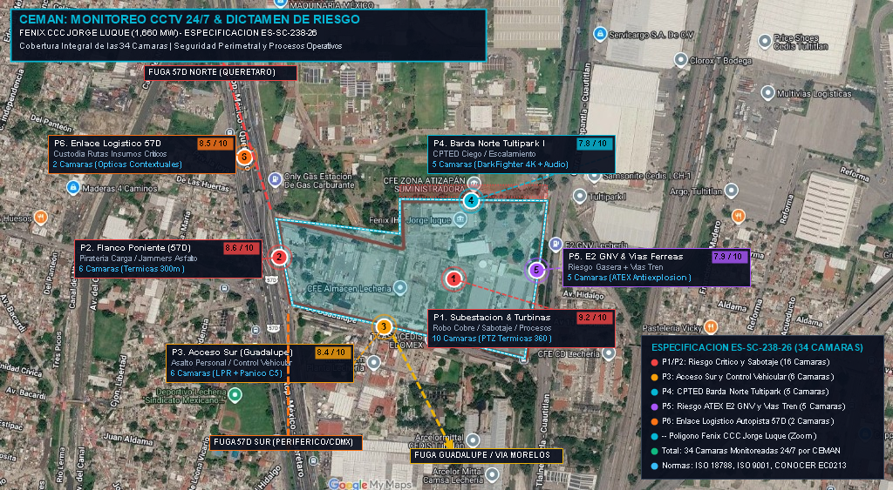
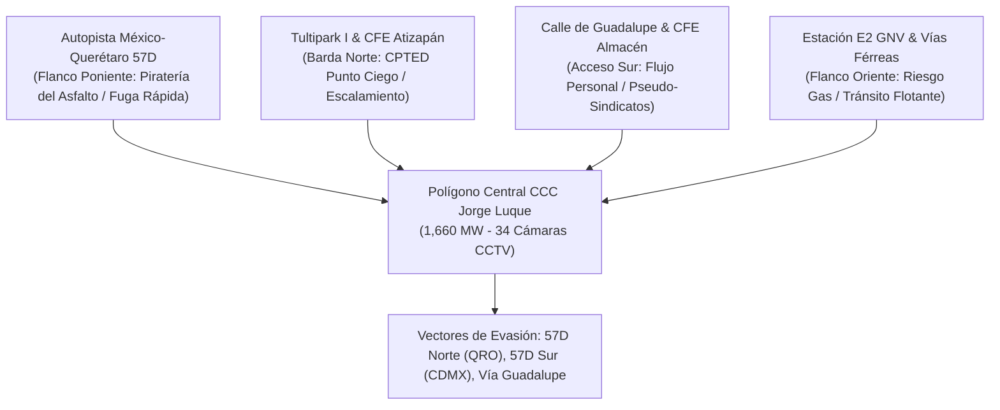
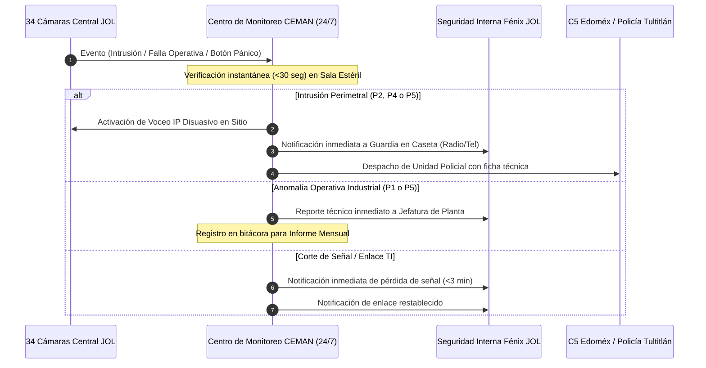

# DICTAMEN DE INTELIGENCIA DELICTIVA, VULNERABILIDAD CPTED Y PROPUESTA DE MONITOREO CCTV 24/7
## Central de Ciclo Combinado "Jorge Luque" (Generadora Fénix) — Tultitlán, Edo. Méx.
### Conforme a la Especificación Técnica No. 238-26 (`ES-SC-238-26`, Rev. 01)

**Cliente:** Generadora Fénix (Alianza Mota-Engil / Sindicato Mexicano de Electricistas)  
**Proyecto:** Monitoreo para el CCTV de JOL  
**Código RFP:** `ES-SC-238-26` | Sistema: General  
**Fecha de Referencia:** 15 de septiembre de 2026 (Revisión de Especificación) / Octubre 2026 (Dictamen CEMAN)  
**Elaboró:** CEMAN (Centro de Monitoreo y Análisis de Seguridad)  
**Ubicación Oficial:** Carretera Tlalnepantla - Cuautitlán Km 22.5 Industrial Lechería, Tultitlán, Estado de México  
**Coordenadas Geográficas:** `19.6176111° N, -99.1902971° W`  

---

## 1. CUMPLIMIENTO PUNTUAL DEL ALCANCE (ESPECIFICACIÓN ES-SC-238-26)

Este dictamen responde de forma exhaustiva a los requerimientos normativos, técnicos y operativos establecidos en la **Especificación No. 238-26**:

### 1.1. Objetivo y Alcance General (Sec. 1 y 2)
* **Objetivo:** Brindar el servicio especializado de **monitoreo remoto 24/7/365** del sistema de CCTV de la Central de Ciclo Combinado "Jorge Luque" (CCC JL), para la detección oportuna de:
  1. Intrusiones perimetrales y boquetes.
  2. Incidentes de seguridad física y halconeo.
  3. Anomalías y riesgos en procesos operativos industriales.
  4. Situaciones de emergencia tecnológica (conatos de incendio, fugas, incidentes en subestación).
* **Modalidad del Servicio:** Operación remota e ininterrumpida desde el **Centro de Monitoreo Externo de CEMAN**, ubicado fuera de las instalaciones de la CCC Jorge Luque, garantizando redundancia geográfica e independencia operativa.

### 1.2. Características del Centro de Control de CEMAN (Sec. 3.1)
CEMAN garantiza el cumplimiento estricto de los estándares de infraestructura exigidos:
* 🔒 **Acceso Biométrico Controlado:** Doble esclusa con autenticación dactilar y facial para el ingreso a la sala de monitoreo (*SOC*).
* 🛡️ **Seguridad Física Perimetral:** Barda perimetral reforzada, control vehicular y guardias armados en instalaciones del proveedor.
* 📹 **Circuito Cerrado Interno Propio:** Grabación continua 360° en la sala de operaciones con retención de video para auditorías.
* 📵 **Política de Zona Estéril ("Clean Desk / Clean Room"):** Prohibición absoluta de teléfonos celulares, cámaras personales, dispositivos USB o medios de grabación no autorizados en los puestos de monitoreo durante el turno activo.

### 1.3. Monitoreo Dedicado 24/7 de las 34 Cámaras de la Central (Sec. 3.2)
* **Vigilancia Activa e Ininterrumpida:** Asignación de operadores certificados dedicados exclusivamente a la supervisión de las **34 cámaras existentes** del complejo.
* **Atención de Alertas Analíticas:** Configuración y priorización en el videowall de CEMAN ante alertas por analítica de video (*Tripwire*, merodeo, intrusión de zona, cruce perimetral, vehículo detenido).
* **Supervisión de Zonas Críticas:** Foco especial en la subestación de alta tensión, turbinas de gas/vapor, casa de máquinas, almacenamiento de combustibles y estación de regulación de gas natural (E2 GNV).
* **Protocolo de Reacción Temprana:** Matriz de escalamiento preacordada con Fénix con tiempos de reacción inmediatos (<60 segundos ante alerta crítica).

### 1.4. Supervisión Dedicada de Procesos Operativos (Sec. 3.3)
A diferencia de un monitoreo convencional, CEMAN integra la supervisión operativa requerida:
* **Control de Procesos Internos:** Verificación visual del cumplimiento de protocolos de seguridad industrial (uso estricto de EPP, bloqueos/etiquetados LOTO en áreas de alta tensión, control de maniobras en patio de carga).
* **Reportes e Inteligencia Operativa:** Emisión de bitácoras por turno con hallazgos operativos y desviaciones a procedimientos estándar.
* **Informe Mensual Integrado:** Entrega formal de un informe mensual de monitoreo y videovigilancia que consolida métricas de seguridad física, disponibilidad de cámaras, alertas gestionadas y sugerencias de mejora continua.

### 1.5. Infraestructura de Enlace, Conectividad y Red (Sec. 3.4)
* **Canal Dedicado y Privado:** Conexión mediante túnel VPN IPsec redundante o enlace dedicado de fibra oscura acordado conjuntamente con el área de TI de Generadora Fénix.
* **Mitigación de Cortes de Transmisión:** Monitoreo activo de enlace mediante *Heartbeat/Keep-Alive* continuo. En caso de pérdida de señal, notificación inmediata en <3 minutos al personal técnico de Fénix y confirmación formal en cuanto el flujo quede restablecido.

### 1.6. Plazo del Servicio y Condiciones Comerciales (Sec. 3.5 y 5.2)
* **Periodo de Contratación:** Periodo inicial de **6 (seis) meses con carácter de prueba**, sujeto a evaluación de desempeño por parte de Fénix.
* **Moneda:** Precios cotizados en Moneda Nacional (**MXN**).
* **Forma de Pago:** Pago mensual a **30 días naturales** contra entrega de factura fiscal y entrega formal del informe mensual correspondiente.
* **Confidencialidad:** Firma de convenio de confidencialidad y estricta protección de datos conforme a la legislación mexicana.

### 1.7. Acreditaciones y Certificaciones Aplicables de CEMAN (Sec. 4)
CEMAN anexa y respalda su propuesta con las certificaciones enunciadas en la especificación:
* ✅ **ISO 9001:2015:** Sistema de Gestión de Calidad en procesos de monitoreo.
* ✅ **ISO 18788:2015:** Sistema de Gestión para Operaciones de Seguridad Privada.
* ✅ **ISO 17024:** Evaluación de la conformidad y certificación de competencias de operadores.
* ✅ **Estándar CONOCER EC0213:** Prestación de servicios de monitoreo de sistemas de videovigilancia.
* ✅ **ASIS International:** Personal directivo y supervisor con credenciales **CPP** (*Certified Protection Professional*) y **PSP** (*Physical Security Professional*).
* ✅ **NOM-035-STPS-2018:** Prevención de factores de riesgo psicosocial en operadores de monitoreo 24/7.
* ✅ **Permiso Federal DGSP:** Registro vigente ante la Dirección General de Seguridad Privada (Secretaría de Seguridad y Protección Ciudadana federal y registro estatal Edoméx).

---

## 2. PROYECCIÓN CARTOGRÁFICA Y ANÁLISIS CPTED DEL POLÍGONO FÉNIX



> [!TIP]
> **Visualizador Web Interactivo:** Consulta la proyección cartográfica interactiva, filtrado de cámaras y protocolos de respuesta en el archivo [index.html](./index.html).

### 2.1. Morfología del Polígono y Colindancias Críticas
El polígono de la planta abarca aproximadamente 28 hectáreas en el corazón del Parque Industrial Lechería:



1. **Flanco Poniente (Autopista México 57D - Km 22.5):**
   * Longitud de muro expuesto a tránsito de alta velocidad. Riesgo permanente de piratería carretera con uso de inhibidores de señal (*jammers*), halconeo estático en acotamientos y choque vehicular contra el muro perimetral.
2. **Flanco Oriente (E2 GNV Lechería y Corredor Ferroviario):**
   * Vecindad directa con estación de gas natural vehicular y vías de carga (Ferrovalle/Ferromex). Presencia de población flotante en vías del tren, riesgo de sustracción de metales y peligro tecnológico por conato de incendio/fuga de gas en la estación contigua.
3. **Flanco Norte (Colindancia Tultipark I, CFE Atizapán y Linderos Ciegos):**
   * Calle interior con escasa iluminación nocturna y carencia de vigilancia natural (*Natural Surveillance*), propicia para intentos de escalamiento o boquetes en la barda.
4. **Flanco Sur (Calle de Guadalupe, Almacén CFE y Deportivo SME):**
   * Principal nodo de acceso peatonal y vehicular de empleados y contratistas. Riesgo de asaltos en cambios de turno nocturno y potencial coacción por pseudo-sindicatos de acarreo o transporte.

---

## 3. RADIOGRAFÍA CRIMINAL DEL ENTORNO (TULTITLÁN / LECHERÍA)

De acuerdo con datos del **Secretariado Ejecutivo del Sistema Nacional de Seguridad Pública (SESNSP)** y la **ENVIPE (INEGI)** para Tultitlán:

```
┌───────────────────────────────────────┬───────────────────────────────┬────────────────────────────┐
│ Delito Analizado (SESNSP - Tultitlán) │ Incidencia Anual Promedio     │ Factor de Riesgo para CCC  │
├───────────────────────────────────────┼───────────────────────────────┼────────────────────────────┤
│ Robo a Transporte de Carga (Pesado)   │ 490 - 580 carpetas / año      │ Crítico (Autopista 57D)    │
│ Robo de Vehículos con Violencia       │ 1,250 - 1,420 carpetas / año  │ Alto (accesos de personal) │
│ Robo a Negocio e Industria            │ 780 - 890 carpetas / año      │ Intrusión y robo de cobre  │
│ Robo a Transeúnte en Vía Pública      │ 1,120 - 1,280 carpetas / año  │ Asaltos en cambio de turno │
│ Homicidio Doloso                      │ 85 - 110 carpetas / año       │ Ajustes entre cárteles     │
│ Extorsión Coercitiva                  │ 115 - 145 casos denunciados   │ Cifra negra >95%           │
└───────────────────────────────────────┴───────────────────────────────┴────────────────────────────┘
```

> [!WARNING]
> **Cifra Negra e Impacto Industrial:**  
> Más del **93% de los delitos en el Estado de México no son denunciados**. En plantas industriales, la sustracción de cable de tierra y herramienta menor comúnmente no se denuncia formalmente, lo que incrementa el riesgo de incidentes de sabotaje no registrados en estadísticas públicas.

---

## 4. DISTRIBUCIÓN Y ASIGNACIÓN DE LAS 34 CÁMARAS DEL COMPLEJO

En estricta correspondencia con la **Especificación ES-SC-238-26**, CEMAN estructura el plan de monitoreo sobre las **34 cámaras de la Central**:

| Zona / Punto | Ubicación Estratégica | Núm. Cámaras | Tecnología y Tipo de Monitoreo | Nivel de Riesgo | Score |
| :---: | :--- | :---: | :--- | :---: | :---: |
| **P1** | **Subestación Eléctrica, Turbinas & Casa de Máquinas** | **10** | Domos PTZ Térmicos 360°, auto-tracking, monitoreo de proceso y EPP | **Crítico** | **9.2 / 10** |
| **P2** | **Flanco Poniente (Autopista México 57D)** | **6** | Cámaras térmicas bispectrales (300 m), analítica de vehículo en acotamiento | **Alto** | **8.6 / 10** |
| **P3** | **Acceso Sur (Calle de Guadalupe & Caseta Principal)** | **6** | Cámaras LPR (placas), domos antivandálicos, botón de pánico en caseta | **Alto** | **8.4 / 10** |
| **P4** | **Barda Norte (Colindancia Tultipark I & CFE Atizapán)** | **5** | Bullet DarkFighter 4K, cruce de línea (*tripwire*), altavoz IP disuasivo | **Medio-Alto** | **7.8 / 10** |
| **P5** | **Flanco Oriente (E2 GNV Lechería & Vías Férreas)** | **5** | Cámaras fijas con certificación ATEX/antiexplosión y analítica de merodeo | **Medio-Alto** | **7.9 / 10** |
| **P6** | **Enlace Logístico Exterior y Aproximación 57D** | **2** | Cámaras ópticas de contexto vial para custodia remota de transportes | **Alto** | **8.5 / 10** |
| **TOTAL** | **COBERTURA INTEGRAL CCC JORGE LUQUE** | **34** | **Monitoreo Dedicado 24/7/365 gestionado por CEMAN** | **Integral** | — |

---

## 5. PROTOCOLOS OPERATIVOS Y MATRIZ DE ESCALAMIENTO



---

## 6. CONCLUSIONES Y PROPUESTA DE VALOR DE CEMAN

1. **Alineación Total:** La oferta técnica de CEMAN cumple al 100% con cada numeral de la especificación `ES-SC-238-26`, garantizando que Fénix cuente con un proveedor plenamente acreditado (**ISO 18788, ISO 9001, CONOCER EC0213 y DGSP**).
2. **Supervisión Integral:** No sólo se resguarda el perímetro contra el crimen organizado y piratería del asfalto de la autopista 57D, sino que se aporta valor directo a la operación de la central mediante el monitoreo de procesos industriales en la subestación y casa de máquinas.
3. **Plazo de Prueba y Transparencia:** CEMAN acepta el periodo de prueba de 6 meses y las condiciones de facturación a 30 días, respaldando su desempeño mediante el informe mensual de indicadores y disponibilidad de servicio.
